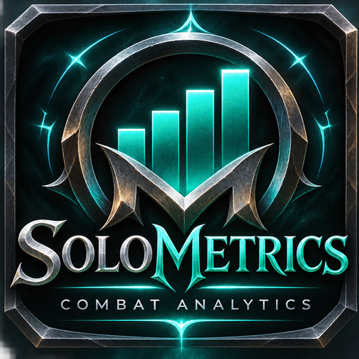

<p align="center"></p>

# SoloMetrics

A lightweight, fully customizable **personal** damage meter for **World of Warcraft: Forever**.
It shows your own damage, DPS and per-ability breakdown **live during combat**, plus independent
graph widgets, using the client's native `C_DamageMeter` API. No external programs or services.

## Features

- **Live personal meter** — DPS, total damage, fight timer, Current / Overall session; per-spell rows
  with icon, name, damage, DPS and a smoothly animated bar (relative to your top spell or as a share of
  your total). Updates live in combat.
- **Fully customizable appearance** — background, border, accent line, header, rows, icons, bar fill
  and background, fonts, outlines, shadows, per-column alignment and colors, opacity per element.
  Strip it down to bars and text only. Presets: Modern Dark, Ultra-Minimal, Text-Only, Compact.
- **Settings window** (`/sm config`, minimap button, addon compartment) — search, instant preview,
  per-setting and per-category reset, revert, themed color picker with hex input, live DEMO preview.
- **Profiles** — create, duplicate, rename, delete, per-character profile, share codes (export/import,
  appearance only, validated).
- **Graph widgets** (up to 12) — independent windows you can move, resize, lock, make click-through and
  show always / in combat / out of combat. Each has its own settings window and appearance.
  - **Live**: "Average DPS so far" or "Total damage", sampled over a fixed time window.
  - **Per fight**: one column per completed fight (last 30), for you or for a single spell
    (damage, DPS, share of your damage). Right-click a spell in the meter to create one.
  - Styles: area, columns, line, points; grid, scale labels; auto, focus or fixed scale.
- **Counter widgets** — one big number anywhere on screen: live DPS or damage (current / overall), or
  last-fight values (including a single spell's damage, DPS or contribution). Optional title, suffix,
  secondary value (total, DPS, fight time), accent line; presets Minimal number / Compact DPS / Modern panel.
  Can be a floating number with no background at all.
- **Grow direction** up or down, scale that keeps its position, click-through lock, `/sm resetui` recovery.

### What the game allows (and doesn't)

During combat the game hides damage numbers and spell identities from addon code. SoloMetrics never
reads, compares or stores those values — it passes them straight to the game's own display functions,
which is why the meter and live graphs still work. Consequences:

- Live graphs show the game's **running average** DPS (total ÷ time), not per-second DPS.
- **Live per-spell graphs aren't possible** (a spell can't be identified in the live list); spell graphs
  are per fight and update after each fight.
- Percentages, custom number formats and true high/low scaling are available only for finished fights.

Details: [docs/API_VALIDATION.md](docs/API_VALIDATION.md), [docs/DECISIONS.md](docs/DECISIONS.md).

## Install

Copy the `addon/SoloMetrics` folder into `World of Warcraft\_forever_\Interface\AddOns\` so that
`AddOns\SoloMetrics\SoloMetrics.toc` exists. Restart the game.

## Commands

| Command | |
| --- | --- |
| `/sm` | show / hide the meter |
| `/sm config` | settings window |
| `/sm edit` / `/sm lock` | unlock to move / lock (click-through) |
| `/sm test [seconds] [big]` | DEMO fight preview (fake numbers, labeled) |
| `/sm widget` | graph widgets (`new`, `list`, `edit`, `<id> ...`) |
| `/sm profile` | profiles page |
| `/sm grow`, `/sm bars`, `/sm session`, `/sm format`, `/sm rows N` | quick toggles |
| `/sm minimap` | show / hide the minimap button |
| `/sm resetui` | recover a lost meter (keeps data) |
| `/sm help` | all commands, incl. diagnostics (`debug`, `probe`, `watch`, `rendertest`, `graphtest`) |

## Development

Source lives in this repo; the game folder only receives copies.

1. Copy `dev.local.example.json` to `dev.local.json` and set `wowAddonsDir` to your
   `...\_forever_\Interface\AddOns` path (git-ignored).
2. Preview: `deploy.cmd -DryRun` — Deploy: `deploy.cmd`
3. In game: `/reload` for Lua changes; restart the game after new files or `.toc` changes.

The deploy script refuses non-Forever clients, any destination not named `AddOns\SoloMetrics`,
and an existing `SoloMetrics` folder it did not create; it only removes files it previously deployed
and verifies every copied file by SHA-256. `scripts/Validate-SoloMetrics.ps1` (run automatically)
checks the TOC, Lua safety rules and textures.

### Adding bar textures

1. Put a `.tga` (power-of-two size, e.g. 512x128; uncompressed or RLE) in `addon/SoloMetrics/Assets/Textures/Custom/`.
2. Run `powershell -ExecutionPolicy Bypass -File scripts\Update-TextureIndex.ps1`.
3. Deploy and restart WoW. Neutral grey textures work best (they're tinted by the bar color).

## Layout

```
addon/SoloMetrics/   installable payload (only this goes into WoW)
  Core/              bootstrap, API adapter, secret-safety helpers, diagnostics
  Appearance/        style schema, presets, validation
  Analytics/         DEMO simulator
  UI/                meter, graph renderer, widget manager, menus, minimap button
  Settings/          settings window, panel controls, widget windows, profiles
  Assets/            icons, textures, generated texture index
scripts/             validate / deploy / texture index
docs/                API findings, feature matrix, status, decisions, widget design
branding/            logo art (not deployed)
```
